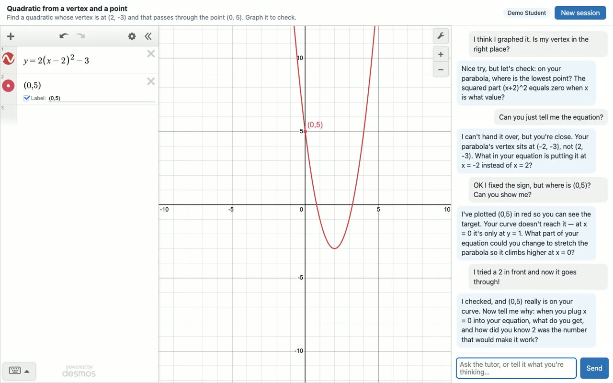

# Socratic Desmos Tutor (v0.1)

A local web app with a Desmos graphing calculator on the left and a tutor chat on the right. The
tutor watches the student's graph as it changes and guides them with one question at a time. It
never hands over the answer. Every session is logged so a teacher can replay how the student's
thinking moved.

It's built for the hard problems, the ones where a stuck student reaches for an answer machine. The
tutor makes working through the problem yourself the faster path. **Project page:**
https://killercatfish.github.io/desmos-tutor/

[](https://killercatfish.github.io/desmos-tutor/#demo)

**[Watch the two-minute demo](https://killercatfish.github.io/desmos-tutor/#demo)** ([or download the video](docs/demo.mp4))

> **Status: early.** The tutor has run against one real model so far (Qwen3.8 27B, Q4_K_M, under
> llama.cpp) with a simulated student, and passed: it refused the answer three ways, plotted the vertex
> when the student was stuck, checked the student's point with a tool, and asked for an explanation
> before confirming. It has not been used by real students. If you try it with your own model, please
> share what happens. See [Contributing](#contributing).

By default every model call goes to a model running on your own machine or network. There are
no cloud APIs, no telemetry, and no analytics.

## Quick start

```sh
npm install
npm run dev
```

- Student view: http://127.0.0.1:5173
- Teacher view: http://127.0.0.1:5173/teacher

The first `npm run dev` copies `.env.example` to `.env`. You still need a model server running
(see below). Without one, the calculator works, but the tutor shows an error when you send a
message.

## Pointing it at a model

Any OpenAI-compatible `/v1/chat/completions` endpoint works. Set two lines in `.env`:

```sh
LLM_BASE_URL=http://localhost:8080/v1
LLM_MODEL=qwen27b
```

Changing the model needs no code changes. Restart `npm run dev` after editing `.env`.
`prompts/tutor_system.md` is re-read on every turn, so you can edit it while the app runs.

| Server | Start it | `.env` |
|---|---|---|
| llama.cpp | `llama-server -m model.gguf --jinja --port 8080` | `LLM_BASE_URL=http://localhost:8080/v1` |
| vLLM | `vllm serve Qwen/Qwen3-32B --enable-auto-tool-choice --tool-call-parser hermes` | `LLM_BASE_URL=http://localhost:8000/v1`, `LLM_MODEL=Qwen/Qwen3-32B` |
| Ollama | `ollama serve` (and `ollama pull qwen3:32b`) | `LLM_BASE_URL=http://localhost:11434/v1`, `LLM_MODEL=qwen3:32b` |
| LM Studio | start the local server in the app | `LLM_BASE_URL=http://localhost:1234/v1` |
| llama-swap on a LAN GPU box | already running | `LLM_BASE_URL=http://192.168.1.50:11434/v1`, `LLM_MODEL=qwen27b` |

**Tool calling.** The tutor uses OpenAI-style function calling. llama.cpp needs `--jinja` for that,
and vLLM needs the two tool flags above. If the endpoint refuses tools, the app switches by itself to
a fallback, where the model writes tool calls as ```` ```tool ```` JSON blocks. Set `LLM_TOOL_MODE=json`
to force the fallback, or `native` to turn it off.

**Thinking models.** `<think>…</think>` text is stripped before the student sees anything. To turn
thinking off on servers that support it, pass extra request fields with, for example,
`LLM_EXTRA_BODY={"chat_template_kwargs":{"enable_thinking":false}}`.

**Proxies that can't stream.** With `LLM_STREAM=auto` (the default) the app streams replies, and if
the endpoint or a proxy in front of it fails on a streamed request, it switches to one-shot replies
for the rest of the run. Set `LLM_STREAM=false` to skip the failed first try.

**Request labels.** For private-network endpoints, every request carries
`X-HKOS-Requester: desmos-tutor.tutor` (or `.simulate`) and `X-HKOS-Trace`. These headers are
never sent to outside providers.

## Student data and cloud providers

**Real students: use a local model only.** Then nothing a student types or graphs leaves the machine.

`.env.example` also has commented-out presets for Gemini's OpenAI-compatible endpoint, OpenRouter
and Groq. These are **for development and testing with fake students only.** Those providers may
log or train on everything sent to them.

`PROVIDER_TRAINS_ON_DATA` controls demo mode. If you leave it unset, it's `false` for localhost and
private-network addresses (10.x, 172.16–31.x, 192.168.x, Tailscale 100.64–127.x, `.local`) and `true`
for everything else. When it's `true`:

- a yellow banner says *"Demo mode — don't type your real name or personal info"*;
- nicknames are auto-generated (like "Blue Heron 42"), and the nickname field is hidden. The server
  ignores any typed name.

Setting it to `false` for a cloud endpoint removes those guards. Only do that if a data agreement
covers the endpoint (for example, a school's own Vertex AI project in a later version).

## Desmos API key

`.env.example` ships the **public demo key** from the Desmos API docs. It's fine for local
development. **Deploying anywhere needs your own key** (https://www.desmos.com/my-api): set
`DESMOS_API_KEY` in `.env`.

## Problems

Problems live in `problems/*.json`:

```json
{
  "id": "a-quadratic-vertex",
  "title": "…",
  "statement": "student-facing text",
  "goal": "teacher-facing: what mastery looks like",
  "common_misconceptions": ["…"],
  "hint_ladder": ["vague", "…", "specific"],
  "starter_expressions": [
    { "id": "tutor_target", "latex": "y=…", "owner": "tutor", "lineStyle": "DASHED", "secret": true, "readonly": true },
    { "id": "s_a", "latex": "a=1", "sliderBounds": { "min": "-5", "max": "5", "step": "0.5" } }
  ]
}
```

Starters with `"owner": "tutor"` are locked: the tutor can't remove them either. `secret` hides the
equation in the expression list, so the student only sees the curve.

## Math tools

Desmos is a visual tool, not a symbolic one, and language models are unreliable at algebra. So the
tutor never judges math on its own; it calls tools and keeps the results to itself.

- **`check_point_on_expression`, `evaluate`**: exact values on the student's curves, with their slider values.
- **`check_equivalent`**: is an algebra step valid? It compares two expressions (`2(x+3)` vs `2x+6`),
  two equations (same solutions? `2(x+3)=10` vs `x+3=5`), or tests one equation as an identity, by
  evaluating at many values of every variable. Dividing by a variable or squaring both sides shows up as
  not equivalent. Runs in the server; nothing to install.
- **`symbolic`** (optional): solve, factor, expand, simplify, derivative, integral and limit, from a
  small local SymPy service in `sidecar/`. The prompt tells the tutor to use the result only to plan its
  next question, never to paste it to the student.

```sh
npm run sympy:setup   # once: creates sidecar/.venv and installs SymPy (needs Python 3.10+)
npm run dev           # starts the sidecar too, when it's set up
```

The sidecar listens on `127.0.0.1` only. It never receives LaTeX: the server converts LaTeX to plain
math text first, and the sidecar rejects anything outside that small alphabet before SymPy parses it,
because SymPy's parser evaluates code. Each operation runs in a child process that is killed after 5 s.
Set `SYMPY_URL=` (empty) to turn the tool off.

## How the tutor can (and can't) touch the graph

The tutor can add, remove and highlight **only expressions whose id starts with `tutor_`.** The code
enforces this, not just the prompt: `shared/guard.ts` runs on the server before an action is sent
and again in the browser before the calculator is touched. Highlighting draws a temporary tutor
copy on top, so the student's expression is never modified. `test/guard.test.ts` tries to break this
at every layer.

## Prompt tuning

```sh
npm run simulate              # fake student works problem (a) against the model in .env
npm run simulate -- --verbose # include tool results
npm run simulate -- --save    # also save the run so /teacher can replay it
```

The script flags answer leaks and turns that break the length rules, and it checks whether the tutor
plotted the vertex when the student got stuck.

## Other settings

| Variable | Default | |
|---|---|---|
| `HOST` / `PORT` | `127.0.0.1` / `3001` | API server. Vite (5173) proxies `/api` to it. |
| `DB_PATH` | `data/tutor.db` | SQLite file (gitignored). |
| `NUDGES_ENABLED` | `false` | Tutor speaks up after `IDLE_NUDGE_SECONDS` (90) idle, or after 3+ edits without chat. |
| `FEATURE_GOOGLE_SIGNIN` | `false` | Stub only in v0.1. |
| `LLM_TEMPERATURE` / `LLM_MAX_TOKENS` | `0.4` / `1024` | |
| `LLM_STREAM` | `auto` | `true`, `false`, or `auto` (stream, fall back to one-shot replies). |
| `SYMPY_URL` | `http://127.0.0.1:3002` | SymPy sidecar for the `symbolic` tool; empty turns it off. |

## Scripts

`npm run dev` · `npm test` · `npm run typecheck` · `npm run build` then `npm start` (serves the
built frontend from the API server) · `npm run simulate` · `npm run sympy:setup` · `npm run sympy` ·
`npm run test:sidecar`

## Layout

```
server/      Fastify API: app.ts (routes), llm.ts (the only model client), tutor.ts (turn loop),
             tools.ts (tool specs + guard), math.ts (LaTeX → mathjs checker, step checking),
             symbolic.ts (SymPy sidecar client), db.ts (SQLite), config.ts, privacy.ts,
             auth/google.ts (stub)
sidecar/     sympy_server.py: optional local SymPy service, and its tests
shared/      Used by server and browser: types, graph diff, tutor-id guard
web/         Vite frontend: index.html (student), teacher.html (timeline + replay)
problems/    Problem files
prompts/     tutor_system.md, the editable Socratic policy
scripts/     simulate.ts, ensure-env.ts, sympy.ts
test/        vitest
```

## Roadmap

Rough order, nothing promised.

1. **Test against more local models.** One model has passed the simulated student so far. Run the
   simulate script against others, tune `prompts/tutor_system.md` from the transcripts, and record
   which models follow the rules. Problems that need the new math tools need simulate scripts too.
2. ~~Step checking~~ and ~~a symbolic engine~~: done, see [Math tools](#math-tools).
3. **GeoGebra where Desmos falls short.** Geometry constructions and a visible CAS, without making
   students pick a tool: the problem or the tutor decides, and the student's work carries over.
4. **Statistics.** Desmos covers descriptive stats and regressions. Full inference workflows (tests,
   intervals, simulation) would need a backend such as SciPy.

**Design rule for anything grade-related:** reward growth, never penalize asking for help. If
hints cost points, students stop asking the tutor and go back to answer machines.

## Contributing

Issues and pull requests are welcome. The most useful things right now:

- Run `npm run simulate -- --verbose` against your local model and post the transcript in an issue,
  noting the model and server you used. Answer leaks and multi-question turns are the main things to
  watch for.
- Improve the teaching policy in `prompts/tutor_system.md`.
- Add problems in `problems/` (format above).
- Report bugs, or send fixes of any size. Run `npm test` and `npm run typecheck` before a PR.

## License

MIT. See `LICENSE`. Desmos is a trademark of Desmos Studio PBC; this project is not affiliated with it.
